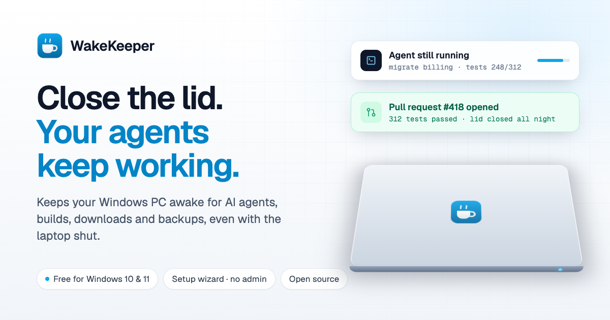

# WakeKeeper



Keep your Windows PC awake while AI agents, builds, downloads and backups run, even with the laptop lid closed.

**Download:** [WakeKeeper-Setup.exe](https://github.com/SurajsinghBayas/wakekeeper/releases/latest/download/WakeKeeper-Setup.exe) · [Portable .zip](https://github.com/SurajsinghBayas/wakekeeper/releases/latest/download/WakeKeeper-Portable.zip) · Windows 10 and 11, 64-bit

## Using it

1. Run **WakeKeeper-Setup.exe** and follow the wizard. No administrator rights are needed. If SmartScreen appears, click **More info**, then **Run anyway**.
2. Click the cup icon next to the clock to keep the PC awake, and click it again to stop.
3. Right-click the cup for timers, *While an app is open*, *Until downloads finish*, **Keep running with lid closed**, and Settings.

To uninstall, go to **Settings › Apps › Installed apps › WakeKeeper › Uninstall**.

## Troubleshooting

- **My PC still went to sleep.** Make sure the cup in the taskbar is filled in (a session is active). With the lid closed, turn on **Keep running with lid closed** in the menu. Some company-managed PCs block lid changes; WakeKeeper shows a notice when that happens.
- **My PC no longer sleeps when I want it to.** Right-click the cup › **Help & Feedback › Restore Windows Power Settings**. This ends the session and puts your original lid and sleep settings back.
- **Windows says "Windows protected your PC".** The download isn't code-signed yet. Click **More info**, then **Run anyway**.
- **The hot key doesn't work.** Another app may already use Ctrl+Alt+A. Pick a different one in **Settings › Hot Keys**.
- **Something else.** Turn on **Help & Feedback › Diagnostic logging**, reproduce the problem, then attach the file from **Open diagnostic log** to a [new issue](https://github.com/SurajsinghBayas/wakekeeper/issues/new).

## Features

| Feature                    | How it works on Windows                                                                                    |
|----------------------------|------------------------------------------------------------------------------------------------------------|
| Sessions                   | Indefinite, 5–55 minutes, 1–24 hours, for any hours and minutes, until a time, while an app runs, while a download finishes (`SetThreadExecutionState`) |
| Quick Options              | Display sleep, lid-closed mode, screen saver after inactivity, battery limits, lock/cursor on inactivity, auto-start rules, drive spinning, time left on the tray icon |
| Lid-closed mode            | Sets the power plan's lid action to "Do nothing" for the session and restores it afterwards, even after a crash |
| Auto-start rules           | Start automatically on app running, power, battery, Wi-Fi, schedule, idle time, CPU load or a mounted drive |
| Battery guard              | End below a charge level or when unplugged, and restart when plugged back in                               |
| Idle helpers               | Nudge the cursor so chat apps keep you Available, or lock the screen after real inactivity                 |
| Keep drives spinning       | Keeps external drives spinning                                                                             |
| Hot keys                   | Ctrl+Alt+A by default (`RegisterHotKey`)                                                                   |
| Start with Windows         | Per-user startup entry, set by the installer or in Settings                                                |

WakeKeeper has no network code and no telemetry. Settings live in `%APPDATA%\WakeKeeper\settings.json`.

## Building

The app is .NET 8 WinForms, the installer is NSIS, and the website is Vite + React.

```bash
# App (Windows, or anywhere with the .NET 8 SDK; EnableWindowsTargeting allows cross-builds)
dotnet publish -c Release -r win-x64 --self-contained -p:PublishSingleFile=true \
  -p:IncludeNativeLibrariesForSelfExtract=true -p:EnableCompressionInSingleFile=true -p:DebugType=none -o out/full

# Setup wizard (makensis 3.x)
mkdir -p out/release && (cd installer && makensis -DVERSION=1.2.1 WakeKeeper.nsi)

# Website
cd site && pnpm install && pnpm build
```

## Releasing

Upload `WakeKeeper-Setup.exe` and `WakeKeeper-Portable.zip` to a GitHub release with exactly those names. The website links to `releases/latest/download/…`, so it serves the new version without a redeploy. Update the version and SHA-256 values in `site/src/lib/release.ts`.
