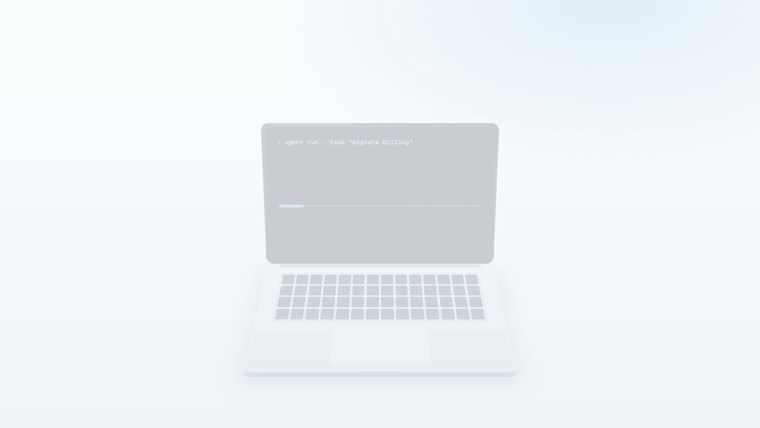

<div align="center">


# WakeKeeper

**Close the lid. Your agents keep working.**

A free Windows tray app that keeps your PC awake while AI agents, builds, downloads and backups run,
even with the laptop lid closed. When the job is done, your normal sleep settings come straight back.

[](https://github.com/SurajsinghBayas/wakekeeper/releases/latest)
[](https://github.com/SurajsinghBayas/wakekeeper/releases)
[](https://github.com/SurajsinghBayas/wakekeeper/actions/workflows/ci.yml)
[](LICENSE)

[**Download for Windows**](https://github.com/SurajsinghBayas/wakekeeper/releases/latest/download/WakeKeeper-Setup.exe) ·
[Portable .zip](https://github.com/SurajsinghBayas/wakekeeper/releases/latest/download/WakeKeeper-Portable.zip) ·
[Website](https://www.wakekeeper.tech) ·
[Report a bug](https://github.com/SurajsinghBayas/wakekeeper/issues/new/choose)

<sub>Windows 10 and 11, 64-bit · no admin rights · no account · no telemetry</sub>

<br>



</div>

## Why WakeKeeper

Windows sleeps when it thinks you've walked away, and it always sleeps when you close a laptop lid. That's great until
an AI agent is halfway through a refactor, a 40 GB game is downloading, or a backup is running overnight.

- **AI agents and long builds.** Let Claude Code, Codex, Cursor or a CI job run for hours, then close the lid and leave.
- **Big downloads and updates.** Stay awake *until downloads finish*, then sleep on its own.
- **Renders, exports and backups.** Keep awake *while an app is open*, and stop when it closes.
- **Presentations and calls.** Keep the screen on, and keep chat apps showing you as Available.
- **Closed-lid setups.** Keep a shut laptop working on your desk or docked to a monitor.

Unlike changing your power plan by hand, WakeKeeper only overrides sleep **while a session runs**, and puts everything
back afterwards, even if the PC crashes or restarts.

## Using it

1. Run **WakeKeeper-Setup.exe** and follow the wizard. No administrator rights are needed. If SmartScreen appears, click **More info**, then **Run anyway**.
2. The WakeKeeper window opens. Click **Keep awake**, or pick a time such as **2 hours**, *While an app is open* or *Until downloads finish*.
3. Close the window whenever you like. WakeKeeper keeps running as a cup next to the clock (click **^** if it's hidden): click the cup to start or stop, right-click it for the menu. Opening WakeKeeper again brings the window back.

To uninstall, go to **Settings › Apps › Installed apps › WakeKeeper › Uninstall**.

## Troubleshooting

- **My PC still went to sleep.** Make sure the cup in the taskbar is filled in (a session is active). With the lid closed, turn on **Keep running with lid closed** in the menu. Some company-managed PCs block lid changes; WakeKeeper shows a notice when that happens.
- **My PC no longer sleeps when I want it to.** Right-click the cup › **Help › Restore Windows power settings**. This ends the session and puts your original lid and sleep settings back.
- **Windows says "Windows protected your PC".** The download isn't code-signed yet. Click **More info**, then **Run anyway**.
- **The hot key doesn't work.** Another app may already use Ctrl+Alt+A. Pick a different one in **Settings › Hot Keys**.
- **Something else.** Turn on **Settings › General › Diagnostic logging**, reproduce the problem, then attach the file from **Open diagnostic log** to a [new issue](https://github.com/SurajsinghBayas/wakekeeper/issues/new).

## Features

| Feature                    | How it works on Windows                                                                                    |
|----------------------------|------------------------------------------------------------------------------------------------------------|
| Sessions                   | Indefinite, 5–55 minutes, 1–24 hours, for any hours and minutes, until a time, while an app runs, while a download finishes (`SetThreadExecutionState`) |
| Main window and tray menu  | Start or stop in one click, common durations, lid-closed mode and keep-the-screen-on, with everything else in Settings |
| Lid-closed mode            | Sets the power plan's lid action to "Do nothing" for the session and restores it afterwards, even after a crash |
| Auto-start rules           | Start automatically on app running, power, battery, Wi-Fi, schedule, idle time, CPU load or a mounted drive |
| Battery guard              | End below a charge level or when unplugged, and restart when plugged back in                               |
| Idle helpers               | Nudge the cursor so chat apps keep you Available, or lock the screen after real inactivity                 |
| Keep drives spinning       | Keeps external drives spinning                                                                             |
| Hot keys                   | Ctrl+Alt+A by default (`RegisterHotKey`)                                                                   |
| Start with Windows         | Per-user startup entry, set by the installer or in Settings                                                |

WakeKeeper has no network code and no telemetry. Settings live in `%APPDATA%\WakeKeeper\settings.json`.

## Building

The app is .NET 8 WinForms, the installer is NSIS, and the website is Vite + React.

```bash
# App (Windows, or anywhere with the .NET 8 SDK; EnableWindowsTargeting allows cross-builds)
dotnet publish -c Release -r win-x64 --self-contained -p:PublishSingleFile=true \
  -p:IncludeNativeLibrariesForSelfExtract=true -p:EnableCompressionInSingleFile=true -p:DebugType=none -o out/full

# Setup wizard (makensis 3.x)
mkdir -p out/release && (cd installer && makensis -DVERSION=1.2.1 WakeKeeper.nsi)

# Website
cd site && pnpm install && pnpm build
```

## Releasing

Upload `WakeKeeper-Setup.exe` and `WakeKeeper-Portable.zip` to a GitHub release with exactly those names. The website links to `releases/latest/download/…`, so it serves the new version without a redeploy. Update the version and SHA-256 values in `site/src/lib/release.ts`.

## Contributing

Contributions are welcome, from bug reports and testing on different laptops to code.

1. Read [CONTRIBUTING.md](CONTRIBUTING.md) for setup, the build commands and what a good pull request looks like.
2. For anything bigger than a small fix, open an issue first so we can agree on the approach.
3. Fork, branch from `main`, and open a pull request. CI builds the app on Windows and the website; both must pass.
4. The maintainer reviews it, and approved pull requests are squash-merged into `main`.

Not a coder? [Run the test plan](https://www.wakekeeper.tech/#test) on your PC and report what you find. It helps a lot.

## License

[MIT](LICENSE) © 2026 Suraj Bayas
